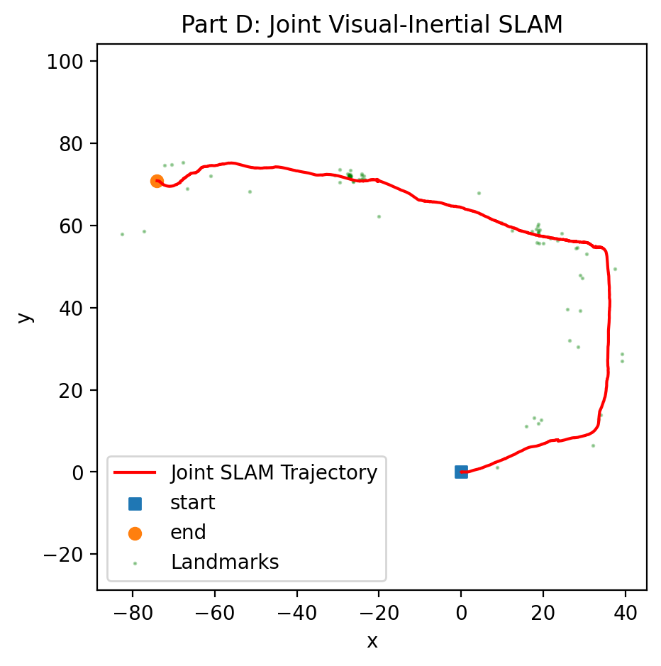
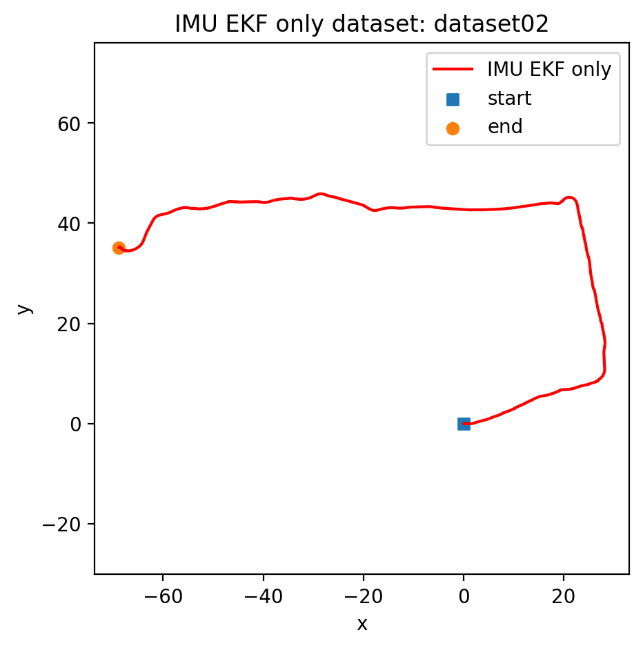
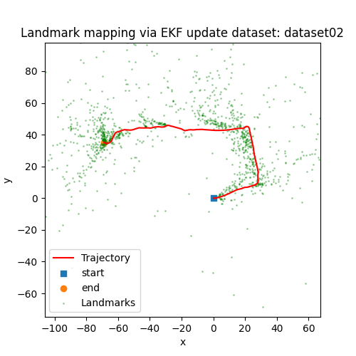

# Visual-Inertial SLAM with a Joint EKF

**UC San Diego ECE 276A · Project 3**

Estimate a moving sensor's trajectory and a 3D landmark map from IMU motion and stereo feature measurements. This project implements an Extended Kalman Filter on SE(3), with IMU prediction, stereo landmark initialization, and joint visual updates.



*Example output from dataset 02: estimated trajectory in red and mapped landmarks in green. This is a qualitative visualization, not a ground-truth accuracy plot.*

## Pipeline

1. Integrate linear and angular IMU measurements to predict pose and uncertainty.
2. Select stereo tracks visible for at least 50 frames, capped at 1,000 features.
3. Triangulate new landmarks from disparity, using camera intrinsics and extrinsics.
4. Apply joint EKF measurement updates with a reprojection-innovation gate. Camera updates run every fourth IMU step in the main script.
5. Save a 2D trajectory and landmark visualization.

`main_a.py` provides the earlier IMU localization and landmark mapping stages for comparison. `main.py` runs the joint filter. `pr3_utils.py` contains data loading, projection, and SE(3) helpers adapted from course starter material.

| IMU trajectory | Landmark mapping |
| --- | --- |
|  |  |

## Run it

Use Python 3.11 or 3.12:

```bash
python -m venv .venv
source .venv/bin/activate  # Windows PowerShell: .venv\Scripts\Activate.ps1
python -m pip install -r requirements.txt
python main.py --filename path/to/dataset02.npy
python main_a.py --filename path/to/dataset02.npy
```

Activate the virtual environment for your platform before installing dependencies.

You can also place `dataset00.npy`, `dataset01.npy`, or `dataset02.npy` under `data/` and run `python main.py --dataset 2`. The input is the ECE 276A dataset dictionary containing IMU measurements, stereo feature tracks, and calibration. The course datasets are not included. NumPy loads the supplied dictionary with pickle support, so use a dataset you trust.

The scripts save plots to `figure/` and open a Matplotlib window. Selected existing outputs are included above. The published verification workflow checks imports and CLI entry points; a full dataset run was not re-verified for this public version because the input data is not present in the project folder.

**Related projects:** [LiDAR-Based SLAM](https://github.com/michaelyuuu/ECE-276A_LiDAR-Based-SLAM) · [Orientation Tracking and Panorama Reconstruction](https://github.com/michaelyuuu/ECE-276A_Orientation-Tracking-and-Panorama-Reconstruction)
